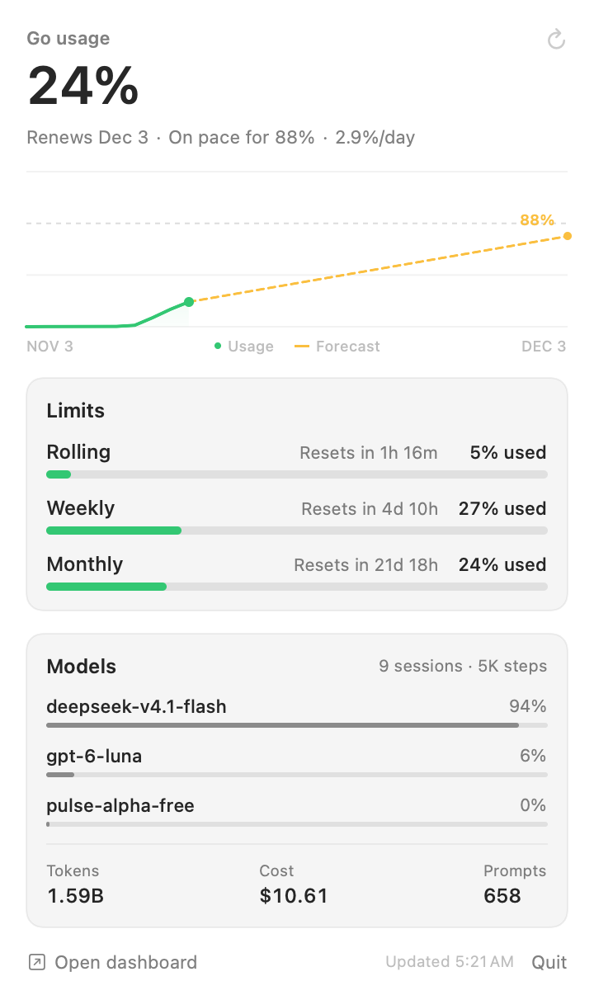
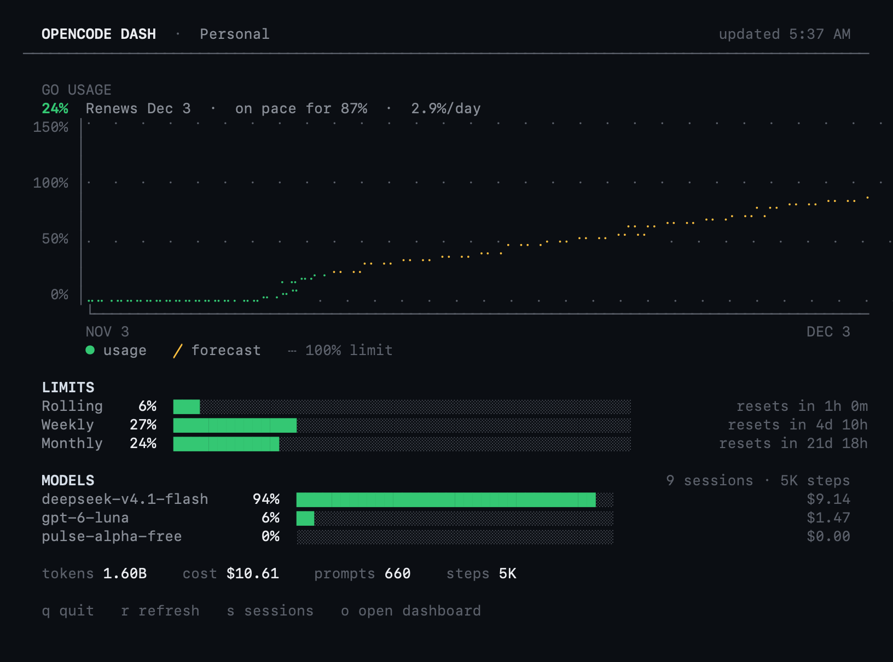

# opencode-dash

Menu bar and terminal dashboards for OpenCode usage. Both read the local
OpenCode service, so no browser session or cloud token is required.





## Layout

```text
swift/   macOS menu bar app (SwiftUI)
go/      terminal dashboard (Go)
docs/    screenshots
```

## Build

The TUI needs Go 1.22+. The menu bar app additionally needs macOS 13+ and the
Swift toolchain (Xcode Command Line Tools).

```sh
./build.sh
```

Outputs:

- `build/opencode-dash` — TUI, builds on macOS, Linux, and Windows
- `build/OpenCodeDash.app` — menu bar app, macOS only

## Run

```sh
open build/OpenCodeDash.app   # macOS menu bar
./build/opencode-dash         # terminal UI
```

| Key | Action |
| --- | --- |
| `q` | quit |
| `r` | refresh |
| `s` | toggle recent sessions |
| `o` | open the web dashboard |

TUI flags: `--once`, `--sessions`, `--no-color`, `--width N`, `--height N`.

Cross-compile the TUI:

```sh
cd go
GOOS=linux GOARCH=amd64 go build -o ../build/opencode-dash-linux .
GOOS=windows GOARCH=amd64 go build -o ../build/opencode-dash.exe .
```

## Data

| Data | Endpoint |
| --- | --- |
| Usage percentages, limits, reset times | `GET /api/experimental/usage/limits` |
| Models, tokens, cost, daily activity | `GET /api/experimental/session/stats` |
| Recent sessions | `GET /api/session` |

The service URL and password come from `$XDG_STATE_HOME/opencode/service.json`,
falling back to `~/.local/state/opencode/service.json`. Requests use HTTP Basic
auth and stay on localhost.

## Notes

- The chart is reconstructed from local daily activity and is an approximation.
- Available credit and the raw request log are cloud-console-only. The TUI uses
  recent sessions as the closest local equivalent.
- To launch the menu bar app at login, copy it to `/Applications` and add it
  under System Settings → General → Login Items.
